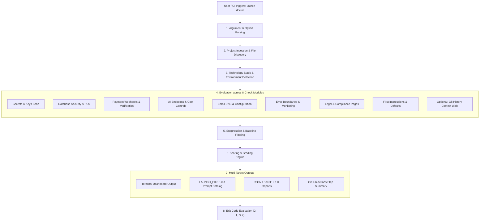
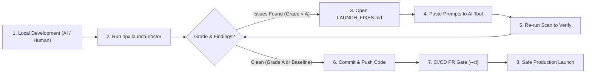

# Launch Doctor

**A pre-launch checkup for vibe-coded apps: one command, an A-F grade, and a fix prompt for every problem.**

[](https://github.com/namaysingh3925/launch-doctor/actions/workflows/ci.yml)
[](https://www.npmjs.com/package/launch-doctor)
[](https://nodejs.org/)
[](LICENSE)

Launch Doctor scans your project for the problems that hurt apps after launch: leaked API keys, databases anyone can read, payments that can be faked, emails that land in spam, AI endpoints that can run up your bill, missing legal pages, and leftover template defaults. It is built for developers who ship with AI coding tools (Claude Code, Cursor, Lovable, Bolt, Windsurf) and may not read every line of generated code. Every finding is explained in plain English and includes a prompt you can paste straight back into your AI assistant. It has no runtime dependencies, requires no account, and your code never leaves your machine.

## Quick start

```bash
npx launch-doctor
```

Scan the built-in sample app full of common mistakes:

```bash
npx launch-doctor --demo
```

Initialize configuration and GitHub Actions files:

```bash
npx launch-doctor init
```

Requires Node.js 22 or newer.

## Example output

```
  Launch Doctor v0.1.0
  Checked my-weekend-saas · 12 files · Vite, React, Supabase, Stripe, OpenAI

  Overall grade  F   Not ready to launch: fix 6 critical issues first

  F  Secrets & keys       2 critical · 1 to fix · 1 to check
  F  Database & backups   2 critical · 1 to check
  F  Payments             1 critical · 2 to check
  F  AI & API costs       1 critical · 1 to fix · 1 to check
  B  Email delivery       1 to fix · 3 to check
  C  Errors & monitoring  2 to fix · 2 to check
  D  Legal & trust        5 to fix
  D  First impressions    5 to fix · 3 to check

  MUST FIX BEFORE LAUNCH (6)

  [CRITICAL] Stripe live secret key is written directly in your code
      src/lib/stripe.ts:1
      This file is sent to every visitor's browser, so anyone can copy the key
      (sk_live_…exe9) and use your account.

  [CRITICAL] Secret exposed through the public variable VITE_OPENAI_API_KEY
      .env:3
      Anything starting with VITE_ gets copied into your website's JavaScript,
      so every visitor can read it. That prefix is only for values that are safe
      to be public.
  ...

  Fix prompts saved to LAUNCH_FIXES.md
```

## Project workflow

Launch Doctor operates across two integrated workflows: an automated internal analysis pipeline that inspects your repository, and a developer-in-the-loop remediation lifecycle designed to pair with AI coding assistants.

### 1. Internal analysis pipeline

The following diagram outlines the multi-stage static analysis pipeline executed on every scan:



#### Pipeline stages in detail

1. **Argument parsing and validation (`src/cli.ts`):**
   Evaluates CLI flags, path arguments, targeted categories (`--only`, `--skip`), severity thresholds (`--fail-on`), output destinations (`--out`, `--sarif`), and runtime modifiers (`--ci`, `--offline`, `--history`, `--demo`).
2. **Project ingestion and tree traversal (`src/project.ts`):**
   Walks the project root, automatically skipping `node_modules`, build artifacts (`dist`, `build`, `.next`), binary formats, and hidden files. Ingests package manifests (`package.json`, `requirements.txt`, `pyproject.toml`), git status, and `.launchdoctorignore` patterns.
3. **Stack and environment detection (`src/detect.ts`, `src/comments.ts`):**
   Identifies frameworks (Next.js, Vite, React, Vue, Flask, Django), database configurations (Supabase, Firebase, Prisma), payment gateways (Stripe, Razorpay), error trackers (Sentry, PostHog), and email services. Prepares a comment-stripped view of source files so commented-out code is not mistaken for active protection.
4. **Multi-category check execution (`src/checks/`):**
   Runs audits across all 8 categories. If `--history` is enabled, an incremental git commit walker inspects the last `n` commits (default 500) for secrets that were removed from HEAD but remain exposed in commit history.
5. **Suppression and baseline matching (`src/baseline.ts`):**
   Applies inline `launch-doctor-ignore <id>` comments and `.launchdoctorignore` path or id rules. If `.launchdoctor-baseline.json` is present and baseline mode is active, matches existing findings by ID, relative file path, and line content fingerprint.
6. **Scoring and grading engine (`src/grade.ts`):**
   Calculates category and overall scores from weighted deductions. Strict scoring ceilings ensure that any critical finding caps both the category score and the overall score at 39 (grade F).
7. **Multi-target reporting and artifact generation (`src/report.ts`, `src/fixes.ts`, `src/sarif.ts`, `src/summary.ts`):**
   Renders the CLI terminal dashboard, generates `LAUNCH_FIXES.md` with copy-paste prompts for AI models, outputs structured JSON or SARIF 2.1.0 files when requested, and populates GitHub Actions job summaries via `GITHUB_STEP_SUMMARY`.
8. **Process exit resolution (`src/cli.ts`):**
   Returns exit code 0 for clean runs (or CI runs without findings at or above `--fail-on`), code 1 for CI gate failures, and code 2 for invalid arguments or unexpected runtime errors.

---

### 2. Developer and AI remediation lifecycle

Launch Doctor is built to fit directly into your daily development cycle, especially when pairing with AI assistants:



1. **Pre-flight scan:** Before shipping changes or merging a branch, run `npx launch-doctor` in your workspace.
2. **Review findings:** Check your letter grade (A-F), category breakdown, and critical blockers in the terminal.
3. **Copy prompts to AI tools:** Open `LAUNCH_FIXES.md`. Copy the specific problem prompt or the single batch prompt and paste it into Claude Code, Cursor, Windsurf, Lovable, or Bolt.
4. **Verify remediation:** Re-run `npx launch-doctor` to verify the fixes and watch your grade increase.
5. **Establish baseline for legacy debt:** If you are adopting Launch Doctor on an existing project, run `npx launch-doctor --update-baseline` so CI only reports new issues.
6. **Automate CI gating:** Add `npx launch-doctor --ci` to your pull request workflow to catch regressions before they merge.

## What it checks

| Category | What it catches | Severity range |
|---|---|---|
| Secrets & keys (`secrets`) | Stripe, OpenAI, Anthropic, OpenRouter, Groq, Hugging Face, Supabase, AWS, GitHub, Slack, SendGrid, and Resend keys in code; Supabase `service_role` keys; private keys; database URLs with passwords; secrets in `NEXT_PUBLIC_` / `VITE_` variables; `.env` files committed or not in `.gitignore`; with `--history`, keys still in git history | Warning to critical |
| Database & backups (`database`) | Supabase tables without Row Level Security; policies that let anyone write (`using (true)`); write policies open to any signed-in user; Firebase test-mode or open rules; SQLite on serverless hosting; `prisma db push` / `--accept-data-loss` instead of migrations | Warning to critical |
| Payments (`payments`) | Stripe webhooks that don't verify the signature (each route checked separately); webhooks or global `express.json()` that parse the body before verifying; no webhook at all; Razorpay payments never verified on the server | Warning to critical |
| AI & API costs (`costs`) | Paid AI or SMS APIs called from the browser; `dangerouslyAllowBrowser: true`; AI endpoints with no login check (middleware only counts if it really blocks `/api`); no real rate limiter | Warning to critical |
| Email delivery (`email`) | Resend's test sender; personal Gmail SMTP; sender domains that don't exist; missing SPF or DMARC (live DNS check); Supabase's built-in test mailer | Warning |
| Errors & monitoring (`monitoring`) | No error tracking (Sentry, PostHog, and others); no error boundary or `error.tsx`, so crashes show a blank page | Warning |
| Legal & trust (`legal`) | No privacy policy, terms, refund policy, or contact page; no way for users to delete their account; cookie analytics without consent | Warning |
| First impressions (`first-impressions`) | "Vite + React" / "Create Next App" titles and descriptions; Vite favicon; Lovable default meta tags; no description or social preview image; hard-coded `localhost` URLs | Warning |

Each category also adds **"check yourself"** items for things code cannot show, such as automated database backups, provider spending limits, a real test purchase, and uptime monitoring. Monitoring, legal, and first impressions checks only run on web apps (a frontend framework, server routes, or an `index.html`). Command-line tools and libraries skip them automatically.

## Live site scan

`npx launch-doctor scan https://myapp.com` checks your deployed site the way an attacker would, from the outside. It makes about 40 ordinary `GET` requests and never changes anything. Only scan sites you own or are allowed to test.

| Category | What it catches | Severity range |
|---|---|---|
| Exposed files & keys (`live-exposure`) | `/.env`, `/.git` and SQL backups that can be downloaded (the content is verified, so single-page apps that answer 200 for every path are not flagged); public source maps; API keys inside the JavaScript every visitor downloads | Warning to critical |
| Open database (`live-database`) | Supabase `service_role` key in the page; tables that return rows to anyone holding the public anon key (only `GET`, one row per table, and rows are never saved or shown) | Critical |
| HTTPS & headers (`live-headers`) | Plain http; http that doesn't redirect to https; missing HSTS, Content-Security-Policy, `X-Content-Type-Options`, frame protection and `Referrer-Policy` | Warning to critical |

The report uses the same grades and `--json`, `--ci`, `--fail-on`, `--out` and `--no-file` options. Fix prompts go to `LAUNCH_FIXES_LIVE.md` in the current folder. Run `npx launch-doctor scan --help` for the options.

## Grading

- **Category score** = 100 − 50 per critical finding − 15 per warning.
  - Any critical finding caps the category at 39, which is an F.
  - Without a critical finding the score never drops below 40, so warnings alone cannot produce an F.
- **Overall score** is the weighted average of the categories that ran:
  - Weights: secrets (3), database (3), payments (3), costs (2), email (1), monitoring (1), legal (1), and first impressions (1).
  - Categories that do not apply, or are skipped with `--only` / `--skip`, are excluded.
- **Caps on the overall score:**
  - Any critical finding anywhere caps the overall score at 39 (F).
  - Any warning caps it at 89, so an A requires zero warnings and zero critical issues.
- **Grade tiers:** A ≥ 90, B ≥ 75, C ≥ 60, D ≥ 40, F < 40.
- "Check yourself" items do not alter the numerical grade. Baseline findings count toward the grade for awareness, but are ignored by the `--ci` exit code.

## CLI reference

```
npx launch-doctor [folder] [options]
npx launch-doctor init [folder]
npx launch-doctor scan <url> [options]
```

| Flag | Default | Description |
|---|---|---|
| `[folder]` | `.` | Project folder to check |
| `--domain <domain>` | auto-detected | Domain you send email from; checks SPF, DKIM and DMARC |
| `--out <file>` | `LAUNCH_FIXES.md` in the project | Where to save the fix prompts |
| `--no-file` | off | Don't write the fix prompts file |
| `--json` | off | Print the full report as JSON (no fix file unless `--out` is given) |
| `--sarif <file>` | off | Also write a SARIF 2.1.0 file for GitHub code scanning |
| `--offline` | off | Skip network checks (email DNS) |
| `--ci` | off | Exit with code 1 on findings at or above `--fail-on` (no fix file unless `--out`) |
| `--fail-on <level>` | `critical` | With `--ci`, the lowest severity that fails: `critical` or `warning` |
| `--only <ids>` | all | Run only these categories (comma-separated) |
| `--skip <ids>` | none | Skip these categories (comma-separated) |
| `--history` | off | Also look for keys still in git history |
| `--history-depth <n>` | `500` | How many commits `--history` reads |
| `--update-baseline` | off | Save today's findings to `.launchdoctor-baseline.json` as accepted |
| `--no-baseline` | off | Ignore `.launchdoctor-baseline.json` and show every finding |
| `--demo` | off | Scan a built-in sample app full of mistakes |
| `-h`, `--help` | | Show help |
| `-v`, `--version` | | Show the version |
| `init [folder]` | `.` | Create `.launchdoctorignore` and `.github/workflows/launch-doctor.yml` (never overwrites) |
| `scan <url>` | | Check your deployed site from the outside (see [Live site scan](#live-site-scan)) |
| `--no-db` | off | With `scan`, don't test Supabase tables with the public key found in the page |

Category ids for `--only` and `--skip`: `secrets`, `database`, `payments`, `costs`, `email`, `monitoring`, `legal`, `first-impressions`. Skipped categories show as "skipped" and don't count toward the grade.

**Exit codes**

| Code | Meaning |
|---|---|
| `0` | The scan finished (and with `--ci`, no findings at or above `--fail-on`) |
| `1` | `--ci` was given and there are findings at or above `--fail-on` (baseline findings excluded) |
| `2` | Usage error (unknown flag, invalid argument, folder not found) or a crash |

## Configuration

### `.launchdoctorignore`

One entry per line. Run `npx launch-doctor init` to generate a starter template.

```
no-error-tracking
no-account-deletion
legacy/
scripts/seed.ts
**/*.fixture.ts
```

A plain word without path characters represents a finding id. Anything containing `/`, `*`, or `.`, or matching an existing file or folder on disk, is treated as a path pattern. Finding ids that do not correspond to any known check produce a warning to catch typos.

### Inline ignores

To silence a specific finding at a single line, place a `launch-doctor-ignore <id>` directive on that line or the line directly above it. All directive styles are supported (`//`, `#`, `/* */`, `<!-- -->`, SQL `--`), and multiple ids can be separated by commas:

```ts
// launch-doctor-ignore stripe-test-key
const STRIPE_TEST_KEY = 'sk_test_...';
```

### Baseline

When adding Launch Doctor to an existing codebase, record current findings so CI checks focus exclusively on new issues:

```bash
npx launch-doctor --update-baseline
```

On subsequent runs:
- Matching findings are tagged with `baseline: true` in JSON output.
- They are summarized in terminal output as a single "N existing issues (baseline)" line.
- They are excluded from `--ci` / `--fail-on` failure checks.

Findings are tracked by check ID, file path, and a fingerprint of the offending line, preserving baseline matches even as line numbers shift. Run with `--no-baseline` to display all suppressed findings.

## CI integration

The `npx launch-doctor init` command creates this GitHub Actions workflow:

```yaml
name: Launch Doctor
on: [pull_request]
jobs:
  check:
    runs-on: ubuntu-latest
    steps:
      - uses: actions/checkout@v5
      - uses: actions/setup-node@v5
        with:
          node-version: 22
      - run: npx launch-doctor --ci
```

- **Severity gating:** By default, `--ci` exits with code 1 only on critical findings. Add `--fail-on warning` to fail builds on warnings as well.
- **Job summaries:** When running in GitHub Actions, Launch Doctor automatically writes a markdown summary (including overall grade, category scorecard, and itemized issues with file and line links) to the GitHub Actions job summary tab via `GITHUB_STEP_SUMMARY`.
- **Code scanning alerts:** Export findings to SARIF 2.1.0 format to populate alerts directly in your repository Security tab:

```yaml
      - run: npx launch-doctor --sarif launch-doctor.sarif
      - uses: github/codeql-action/upload-sarif@v3
        if: always()
        with:
          sarif_file: launch-doctor.sarif
```

## Using with AI coding tools

Launch Doctor outputs `LAUNCH_FIXES.md` directly into your project root. Each entry includes the exact file and line number, an explanation of the risk, and a tailored prompt ready to paste into your AI assistant. It also includes a single batch prompt at the top of the file.

### With Claude Code

```bash
! npx launch-doctor
Fix the issues in LAUNCH_FIXES.md one at a time, starting with the critical ones. Explain each change before making it.
```

### With Cursor, Windsurf, Lovable, or Bolt

1. Run `npx launch-doctor` in your integrated terminal.
2. Open `LAUNCH_FIXES.md`.
3. Copy one fix prompt into the chat window.
4. Review and accept the code edit.
5. Re-run `npx launch-doctor` to observe your score improve.

## Privacy and network use

Launch Doctor analyzes your codebase locally on your device. Your source code, findings, and credentials are never uploaded to any remote server. Detected secrets are masked in reports (for example, `sk_live_…exe9`).

- **Email DNS validation:** This is the only network check performed. When your project sends transactional email and a domain is identified (either discovered in code or specified via `--domain`), Launch Doctor queries your system DNS resolver for NS and TXT records (including root SPF, `send.<domain>`, `_dmarc.<domain>`, and common DKIM selectors). No code or private data is transmitted. Pass `--offline` to disable DNS lookups entirely. The `--demo` command never touches the network.
- **Live site scan (`scan <url>`):** sends ordinary `GET` requests to the address you give and to Supabase when your page uses it. Nothing is sent anywhere else, and nothing is uploaded.
- **Git history analysis (`--history`):** Runs local `git log` commands directly on your system without network requests.
- **Package installation:** standard `npx` retrieval via the npm registry.

## Limitations

Launch Doctor provides rapid pre-launch hygiene, not a full penetration test or manual security audit:

- It uses pattern analysis and heuristic inspection; it may occasionally flag safe code or miss complex multi-file logic. Use `.launchdoctorignore` or inline comments where appropriate.
- It cannot inspect third-party web dashboards. Settings configured via web consoles in Supabase, Firebase, Stripe, or cloud hosts appear on the "check yourself" manual checklist.
- JavaScript, TypeScript, and Python codebases receive the deepest static analysis coverage.
- Route analysis works per handler and follows local imports 2 levels deep. Dynamic imports and unusual route shapes may not be followed.

For applications processing significant financial transactions or sensitive personal health data, combine automated checks with a human security review.

## Roadmap

- [x] Live URL inspection (`launch-doctor scan <url>`: exposed `.env`, source maps, security headers, open Supabase tables via anonymous key)
- [ ] GitHub Action bot to post interactive review comments on pull requests
- [ ] Model Context Protocol (MCP) server for direct Claude Code and Cursor integration
- [ ] Extended provider coverage (Clerk, Convex, Appwrite, Lemon Squeezy, Paddle)
- [ ] Mobile framework support (Expo, React Native)

## Contributing

See [CONTRIBUTING.md](CONTRIBUTING.md) for local environment setup, architecture notes, and instructions on creating new checks. All contributors are expected to adhere to the [Code of Conduct](CODE_OF_CONDUCT.md).

## Contributors

Thanks to everyone who has helped build Launch Doctor. Contributors are listed here once their pull request is merged.

- [@namaysingh3925](https://github.com/namaysingh3925): creator and maintainer
- [@SHARAJ379](https://github.com/SHARAJ379): route-aware analysis of AI endpoints (#4)

Want to be on this list? Pick an open issue labelled `good first issue` or `help wanted`.

## Security

Please do not report security vulnerabilities in public issues. Refer to [SECURITY.md](SECURITY.md) for instructions on confidential disclosure.

## License

[MIT](LICENSE)
